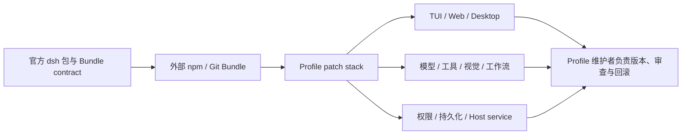

> 这篇记录基于 2026 年 8 月 16 日的源码研究与本地复现，分析提交为 `47f943859b`。

如果只看名字，DeepSeek Harness（下文简称 dsh）很容易被理解成“DeepSeek 版 Codex”：给 DeepSeek 模型接上文件、Shell、搜索和一个 Web UI。这个理解不能说错，但只解释了最表面的启动体验。

我在 Windows 上完成了源码构建，分别跑通 Web 和 Headless，并让它通过真实 DeepSeek SSE adapter 请求仓库自带的本地 Mock 服务。之后再把 UI、Host API、Agent loop、持久化与社区 Bundle 连起来看，我的结论是：dsh 的核心不是默认接入了哪个模型，而是把一个 Agent 产品的 Host、Client、模型、工具、权限和持久化边界公开成可组合的部署契约。

这使它比“一个 Agent SDK”更像可组装的运行时发行版：社区可以替换终端、Web 面板、视觉能力甚至桌面宿主。代价也来自同一处——兼容性、生命周期脚本、插件信任和整棵 Profile 的回归测试，都落到了部署者身上。

## 0. 先给结论：本地能跑，而且 Web 与 Headless 都不是空壳

研究提交是 `47f943859bef60e4160492346772ded9b24f765a`。我把官方仓库加为 `upstream` 后确认：本地 `HEAD`、用户 fork 的 `origin/master` 和官方 `upstream/master` 都是这一提交，已经是 2026 年 8 月 16 日可见的最新源码。

本机环境为 Node `24.15.0`、pnpm `11.19.0`。依赖安装和源码构建通过，随后三个入口都正常展开：

```powershell
cd D:\dsh\deepseek-harness
pnpm dsh --help
pnpm dsh web --help
pnpm dsh web --dump-default-config
```

配置展开不是一张简化示意图，而是实际显示了 `deepseek-official`、`deepseek-v4-flash`、JSONL 持久化、Windows PowerShell 沙箱、workspace-write、ask 审批、子代理、Agent presets 与 Web 客户端模块。

为了不使用真实 API Key，我启动了仓库自带的 OpenAI-compatible SSE Mock。Headless 通过真实 DeepSeek adapter 调用这个本地端点：

```powershell
pnpm mock:llm --port 8000 --api-key mock-key `
  --sequence success --success-text DSH_LOCAL_SMOKE_OK

$env:DSH_HOME = "$env:TEMP\dsh-research-smoke-home"
$env:DEEPSEEK_BASE_URL = "http://127.0.0.1:8000/v1"
$env:DEEPSEEK_API_KEY = "mock-key"
$env:DSH_TELEMETRY_DISABLED = "1"
pnpm dsh --profile headless "local smoke test"
```

最终 stdout 是：

```text
DSH_LOCAL_SMOKE_OK
```

隔离目录中同时出现自动初始化的 Headless profile 和 21,955 字节的 `session.jsonl.zstd`。这说明请求、流式响应、最终输出和会话落盘确实连通。

Web 测试则在 `127.0.0.1:3080` 打开真实界面。我用仓库自带 overlay 把 Windows 原生目录选择器替换成应用内目录浏览器，选择 `D:\dsh\deepseek-harness`，新建标准模式会话并发送测试消息。页面返回 `DSH_WEB_SMOKE_OK`，轨迹页同时展示：初始系统提示、用户消息、`AGENTS.md`/`CLAUDE.md` 注入、workspace-write 权限快照、Skill catalog 和 Assistant 输出。Mock 记录了两次请求：一次主响应，一次会话标题生成；Web 隔离目录落下 22,700 字节的压缩 Session、`workspace.json` 和 projection cache。

这个测试证明的是运行时 wiring，而不是模型能力。固定文本 Mock 不可能证明 DeepSeek 的代码质量、真实延迟、缓存收益或成本。完整命令与边界记录在 [`runtime-notes.md`](runtime-notes.md)。

## 1. 先看启动：不是“启动一个程序”，而是组装一棵插件树

入口在 `apps/cli/src/bin.ts`。合法命令会进入 `profile` 模式，调用 `runProfile()`；`apps/cli/src/profile-boot.ts` 再完成真正的装配：读取 profile，把 bundle patches、profile 自己的 patch、`$DSH_HOME/cordis.patch.yml`、命令行 `--patch` 和 telemetry switch 按顺序叠加。

这不是普通配置文件覆盖。一个 patch 以行 id 为目标，替换整行配置或插入新行；profile 的根 `cordis.yml` 被重写为空 entry list，避免 Loader 把上一次已经组合好的行再次写回导致重复。用户 patch 还被 watch，运行中的树可以重新组合。

这解释了“everything is a plugin”的工程含义：要增加模型提供商，注册 `ctx.llm` adapter；要增加模型工具，注册 `ctx.tools`；要加持久终端、沙箱或 Chat node，则挂到对应 seam。扩展通常不要求修改 loop 本身。

代价也很具体。dsh 不是“装好 Node 就能随便改”的小项目：根配置同时维护 Host/Client 两个 TypeScript aggregate，Typert 在 Host 构建阶段生成 Client 远程契约，Web 构建还要接着消费这些产物。贡献者必须理解 Cordis context、scope/realm、bundle 层次和生成式 API gateway。

## 2. 关键设计：会话日志同时是模型上下文、重放和持久化的因果源

`packages/core/session` 把 `Session` 定义为 append-only event log，并在其上维护面向消息的 surface projection。`packages/core/agent-loop/src/agent.ts` 的 `preStep()` 先 claim inbox 消息，再组装 prompt sections，最后从 session log 派生模型历史；模型请求不是从一个容易漂移的临时数组拼出来的。

这形成一条清晰的数据路径：

```text
用户/外部输入
  → agent inbox
  → turn/start、step/start、user/message
  → prompt sections + deriveMessages(session log)
  → llm/stream
  → assistant/chunk* / assistant/message
  → tool/call → tool pipeline → tool/result
  → 下一 step 或 turn/end
```

架构文档把 `turn/*`、`step/*`、`user/message`、`assistant/*` 和 `tool/*` 定义为 durable session events；`agent/pre-step`、`agent/request`、`llm/stream` 和 `tools/*` 则是实时扩展点。这个区分很重要：需要在 reload、fork、resume 后继续成立的事实写进日志；只用于拦截或观察当前工作的行为放在 live event 上。

我的解读是，dsh 的“可恢复”不是给 Agent 外面套一个存档按钮，而是要求“模型看见的东西必须可由日志重建”。好处是 UI、transcript、telemetry、fork 和模型历史共享同一个事实源；成本是任何新增的模型可见输入都必须扩展 `SessionEventMap`、派生逻辑、持久化和回放测试，演进边界更严格。

## 3. 一次工具调用如何穿过系统：并发只发生在安全的位置

模型返回的 tool-call blocks 进入 `packages/core/agent-loop/src/tool-calls.ts`。该调度器先解析参数，再根据实时 `executionMode()` 将连续的 `parallel` 调用放进 bounded rolling pool；`exclusive` 调用形成 barrier。即使 body 并发执行，`tools/pre-execute`、持久化结果、`post-execute` 和 additional context 仍按模型顺序提交。

取消时，已启动的调用会 drain 并提交结果，尚未启动的调用会追加 `ABORTED_BEFORE_DISPATCH` 的合成结果。这样下一次模型请求看到的是一个平衡的 call/result 序列，而不是半截 transcript。

这是一种保守而实用的折中：读文件、搜索等安全工具可以重叠，写入或依赖共享状态的工具默认独占。限制同样明确：分类是 unary 的，调度器不会推断“两个调用是否操作同一资源”；跨资源安全必须由工具作者声明或保持 exclusive。工具定义里的 `timeoutMs` 也只是元数据，真正的 deadline 需要额外 policy plugin。

## 4. LLM seam：替换提供商，而不是重写 Agent loop

`packages/llm/llm` 只定义 provider-neutral vocabulary：消息、content blocks、stream chunks、`LlmAdapter`、model resolution、retry policy 和错误分类。DeepSeek 的实现位于 `packages/llm/llm-deepseek/src/adapter.ts`，直接用 fetch + SSE parser，将 401/403、429、上下文超限、配额、transport、abort 和 idle timeout 映射为稳定错误码。

一次请求会先冻结 connection facts 和 credential，再创建 stream；因此 endpoint 改动不会让正在进行的流半途读取另一代配置。`prepareCall()` 还会把精确 adapter registration 绑定到异步 model resolution、request header 记录和最终 dispatch，避免 HMR 把“旧模型元数据”和“新适配器”拼在一起。

这也是它与 DeepSeek 最准确的关系。项目确实做了 DeepSeek 专用适配：把 `reasoning_content` 拆成独立思考块，在工具调用轮按官方规则回传思考内容；把 `off/high/max` 映射到 `thinking` 与 `reasoning_effort`；会话标题请求会强制关闭思考；缓存命中 token 从普通输入 token 中拆开记账；DeepSeek 的 SSE 结束符、工具参数碎片、空响应、429、上下文超限和 request id 也有独立处理。这里的“优化”是协议正确性、可观测性与上下文成本核算，不是训练 DeepSeek、修改推理内核，代码里也没有公开 benchmark 能证明它让模型本身更快或更聪明。

值得注意的是，这个 seam 有意保持克制：核心 `GenerateOptions` 只有 temperature、maxTokens、stop 等少数采样字段，没有把所有供应商参数塞进公共接口。好处是 loop 不被供应商细节污染；代价是高级 provider 能力要通过 adapter-owned metadata 或额外插件承载。

## 5. 持久化不是一个文件格式问题，而是副作用边界问题

持久化分成两个层次：`session-persistence` 是 seam，JSONL 和 SQLite 是 provider，`session-checkpoint-policy` 则决定何时必须 flush。

JSONL 后端默认写 `.jsonl.zstd`：header frame 后接带校验的 append frames，可把连续的 assistant chunk 打包；写路径采用固定批处理窗口、fsync 和失败回滚，加载时能截断不完整尾帧并补上工具/step/turn closers。SQLite 后端把每个事件一对一写入 `events` 表，用事务保证一批 append 要么全成要么全退。

更关键的是 checkpoint policy：它在构造下游模型 stream 前 flush，在顶层工具 body 运行前也 flush；如果取消发生在等待 checkpoint 期间，工具不会执行，而是返回 `ABORTED_BEFORE_DISPATCH`。这让“日志里已经记录了调用”与“副作用已经发生”之间有明确边界。

收益是恢复语义可解释：崩溃后没有结果的 durable tool call 会变成 `TOOL_OUTCOME_UNKNOWN`，模型被要求对只读/幂等工作重试，对可能有副作用的工作先验证或询问用户。成本是交互延迟和运维责任：SQLite 的 `DatabaseSync` 会阻塞事件循环，锁冲突没有等待/重试；两种后端都没有删除 API，日志增长需要外部治理；JSONL 压缩模式也不适合直接被普通行工具阅读。

## 6. Code Mode：用一个 typed transport 换取更少的中间上下文

`packages/core/tools/src/code-mode.ts` 将可见工具 schema 编译成 TypeScript 或 Python SDK，模型调用保留的 transport 是 `run_code`。程序内部的 `tools.foo(args)` 会重新进入完整的 pre-execute、guard、execute、post-execute、result pipeline，并复用 normal tool 的并发契约；只有程序打印的日志和最终返回值回到模型上下文，中间结果留在 worker 内。

因此 Code Mode 不是“在 system prompt 里教模型写代码”这么简单，而是新的执行边界：它减少多轮工具结果灌入上下文的机会，同时保留权限和审计管线。代价是每次 run 状态都是 fresh 的，不能当持久 REPL；中间 typed values 没有按字节设硬上限，可能消耗 worker 内存；外层结果虽然有 `maxOutputBytes`，并不能约束所有中间对象。

小型、低延迟任务通常直接工具调用更简单；当工具数量多、需要组合过滤/聚合、而上下文成本成为瓶颈时，Code Mode 才更有意义。

## 7. 工程证据：测试和门禁很强，但性能证据仍然薄

当前 checkout 按文件后缀统计到 883 个 `spec/e2e/stress` 测试文件，根脚本覆盖 build、Host/Client typecheck、lint、unit、snapshot、Web e2e、stress、docs、package invariants 和发布检查。Agent lifecycle、取消竞态、工具调度、JSONL 写后读、SQLite contract、DeepSeek SSE、Web UI 交互都有专门测试；本次研究还实际完成了源码构建、Headless 与 Web smoke test。

这说明项目把“契约正确性”和“回放一致性”放在很高位置。但不能把测试数量等同于生产成熟度：`BENCHMARK.md` 目前只有 Python SDK JSON-RPC benchmark 的运行方法，没有结果表、基线、环境矩阵或独立复现数据。当前证据不足以推导吞吐、成本、长会话延迟或与其他编码 Agent 的质量领先。

## 8. 社区生态已经出现，但“增长”与“治理”发生在不同速度

这次补充调研最出乎我意料的不是 Star，而是社区已经沿着 Bundle 契约长出了不同产品表层。抽样检查的项目都不只是 README 里写了“支持 dsh”，而是能在 manifest 中找到 `dsh.bundle.patch` 或完整的 DSH 子包：

| 社区项目 | 它替换或增加的系统层 | 源码证据 |
|---|---|---|
| [dsh-TUI](https://github.com/ccch1mneyyy/dsh-TUI) | 新的终端前门与 Profile | 根 manifest 声明 Bundle，并验证 upstream contract/patch surface |
| [dsh-web-ui](https://github.com/zhu1090093659/dsh-web-ui) | Web 面板、Git graph、皮肤、统计、远程 UI | 多个子包各自带 `cordis.patch.yml` 和 browser injection |
| [dsh-at-file](https://github.com/omdsh-dev/dsh-at-file) | Composer 的 `@path` 引用 | Bundle + Web client 模块 |
| [modlens](https://github.com/liustack/modlens) | 给文本模型增加视觉/OCR 桥 | Bundle + immediate Web client 模块 |
| [dsh-market](https://github.com/dsh-market/dsh-market) | 把插件市场装进 dsh 自己 | Bundle、registry validation、compat 和 Web tests |
| [DSH Desktop](https://github.com/anywhere-labs/deepseek-harness-desktop) | Electron 桌面宿主和打包运行时 | `dsh-plugin-desktop` 组合完整 rc.6 依赖族 |

为什么能长得这么快？因为 Bundle 不是“再注册一个 tool”这么窄。一个外部包可以贡献 `cordis.patch.yml`，而 patch 能触及 Host service、Agent tool、提示词、持久化、终端或 Web client module。社区不是在同一个应用里加按钮，而是在复用同一运行时重新做发行版。



图：作者根据 Profile/Bundle 代码与社区 manifest 绘制。它解释的是治理责任，不是官方架构图。

截至 2026 年 8 月 16 日的 API 快照非常热闹：官方仓库约 126,111 Star、12,548 Fork，GitHub Discussions 有 2,406 条；npm 下载 API 报告 `@deepseek-ai/dsh` 在 8 月 10–16 日被下载 195,945 次。这些数字能证明注意力和分发速度，不能证明独立活跃用户、生产部署或插件质量。

更值得关注的是治理结构。官方 `CONTRIBUTING.md` 明确说现阶段不接受外部 PR，Issues 也被关闭；贡献被引导到 Discussions、文档和仓库外插件。官方仓库没有 GitHub release/tag，npm 最新是 rc.6，而研究提交里的源码 manifest 仍是 rc.5。与此同时，`dsh-plugin` topic 已混入不少与 dsh 关系很弱的仓库。

因此我的判断不是“生态成熟”，而是“生态真实、治理未定型”。Profile 维护者现在必须像 Linux 发行版维护者一样工作：锁版本、阅读 patch、审查 `prepare` 生命周期脚本、维护插件 allowlist、测试完整组合并准备回滚。Git 托管插件的构建脚本需要 pnpm `allowBuilds`，这只是显式提醒，不是安全审计；插件和 MCP 命令仍可能是 Agent sandbox 外的受信任代码。

完整样本和变化数据记录在 [`ecosystem-notes.md`](ecosystem-notes.md)。

## 9. dsh、Pi 与 Codex：一个是部署运行时，一个是轻量 Harness，一个是完成品

这里不按功能数量打分，因为三者选择了不同的系统边界。

| 维度 | dsh | Pi Agent Harness | OpenAI Codex |
|---|---|---|---|
| 第一抽象 | Cordis 插件树 + Profile 部署 + 事件溯源 Session | Agent core + coding CLI + SDK/RPC + TypeScript extensions | 面向本地仓库的完整 coding-agent 产品 |
| 默认表层 | Web 与 Headless；社区补 TUI/桌面 | TUI 优先，也提供 SDK、RPC、Web/TUI 库 | CLI、桌面/IDE/云等统一产品入口 |
| 模型耦合 | 默认 DeepSeek，但 adapter seam 可替换 | 统一多 Provider API 和自定义模型配置 | OpenAI 模型与 Codex 产品体系 |
| 扩展方法 | Bundle patch 可同时换 Host、Client、工具、策略和应用 | ExtensionAPI 注册事件、工具、命令、UI；资源加载 Skills/模板/主题 | Skills、Plugins、MCP、Hooks 和 SDK/App Server |
| 会话 | append-only durable event log，UI/模型/恢复共享事实源 | JSONL session tree，支持 resume/tree/fork/clone/compact | 产品管理的本地/云会话与自动化工作流 |
| 权限边界 | 内置 read-only/workspace-write/danger-full-access、审批与平台沙箱 | 官方明确无内置 filesystem/process/network/credential 权限系统；建议容器化或外部 sandbox | 官方产品内置权限选择、审批和 sandbox 文档 |
| 成本 | 组合能力最宽，部署与生态治理最重 | 核心更小、扩展更直接，但隔离要另配 | 开箱体验最好，核心产品边界由 OpenAI 管理 |

Pi 是比 Codex 更接近 dsh 的对照组。Pi 同样自称 Agent Harness，也同时交付 Agent core、统一 LLM API、CLI、TUI、SDK/RPC 和扩展系统。它的 ExtensionAPI 能订阅生命周期、注册工具和命令，Project-local extension 还有 trust 流程；但官方 README 明确说 Pi 默认以启动用户的全部权限运行，没有内置文件、进程、网络或凭据沙箱，需要 Gondolin、Docker 或 OpenShell 等外部边界。[Pi 官方仓库](https://github.com/earendil-works/pi)

dsh 选择了更重的道路：把 sandbox、approval、Host/Client、远程契约、持久化与 Web 都放进同一组合系统。Pi 更像“容易嵌入和改造的编码 Agent SDK/CLI”，dsh 更像“可以发布多种发行版的部署 runtime”。如果团队只想编写一个扩展、换模型或嵌入一个会话，Pi 往往更短；如果需要同一 Profile 同时协调浏览器、权限、持久化、子代理和不同前门，dsh 的边界更完整。

Codex 则是另一条坐标。官方文档把 Codex CLI 定义为在终端检查、编辑、运行代码的产品，可以选择模型、推理强度和权限，通过 Skills/Plugins 扩展，并用 `codex exec` 进入脚本和 CI。[Codex CLI 官方文档](https://developers.openai.com/codex/cli) 对普通开发者而言，这种完成度通常比“可重组内核”更有价值；dsh 的优势只有在你真的要拥有和改造运行时，而不是只使用 Agent 时才成立。

## 10. 适用边界与迁移建议

适合采用 dsh 的情况：

- 需要把模型、工具、沙箱、审批、持久化和 UI 作为独立替换点；
- 需要 resume、fork、审计 transcript 或崩溃后可解释恢复；
- 需要 agent preset、子代理、后台 job、workflow 等多种运行形态；
- 团队能接受 pnpm workspace、Cordis realm 和生成式契约的维护成本。

不适合优先采用的情况：

- 一次性脚本或单模型 demo；
- 只有少数工具、没有长会话和恢复要求；
- 事件循环阻塞、磁盘 fsync 或多进程数据库协调不可接受；
- 团队没有能力维护复杂的 Host/Client 构建与插件组合。

如果要落地，我建议先从 `headless` profile、mock LLM、JSONL persistence 和一个最小 agent preset 开始，先验证三件事：模型请求能否从日志重建、工具副作用前后的 checkpoint 是否符合业务语义、profile patch 是否足够表达部署差异。不要一开始就启用全部 Web UI、子代理、workflow 和第三方 provider。

## 11. 可迁移的工程原则

第一，把“模型可见”当作持久化边界，而不是 UI 的渲染细节。任何进入 prompt 的新状态，都必须能从 durable trace 重建。

第二，把能力做成 seam 时同时设计 service definition、provider 和 consumer；只有注册表没有权限/生命周期语义的工具，最终会把策略散落在 loop 和 UI 里。

第三，把并发优化限制在不改变因果顺序的层面。dsh 允许 dispatch overlap，但保持 policy、结果和 context 的模型顺序，这比“所有工具 Promise.all”更容易恢复和审计。

第四，把“副作用前已落盘”作为显式策略。写后日志、模型请求 checkpoint、工具 dispatch checkpoint 和 crash repair 必须分别建模，不能假设一个 append-only 文件自动带来 exactly-once。

第五，把适配器隔离与产品配置分开。provider adapter 负责协议和错误语义，profile/bundle 负责组合；这样 provider 变化不会迫使产品层复制 Agent loop。

## 结论

dsh 的价值在架构边界：Cordis 让能力可重组，session log 让模型上下文可重建，checkpoint policy 让副作用有明确耐久性语义，tool/LLM seams 让 provider 与执行世界可替换。它不是一个轻量“DeepSeek 聊天壳”，也没有足够公开 benchmark 证明自己在所有编码任务上胜过成熟终端 Agent。

本地跑通之后，我会把它放在“值得研究和二次构建的 Agent runtime”位置，而不是“开箱即用的生产终端助手”位置。它已经拥有真实的第三方 TUI、Web、桌面、视觉桥和市场项目，但核心暂不接外部 PR、插件契约仍处于 rc 阶段，意味着开放性主要发生在运行时和发行边界，兼容性与供应链责任则由 Profile 维护者承担。

所以选型关键不是功能清单，也不是 Star 数，而是你是否真的需要这些可替换、可恢复、可审计的边界，并愿意为一套自己的 Agent 发行版负责。只想高质量完成日常编码任务，Codex 这类成品通常更省心；想嵌入一个较小、可直接扩展的 Harness，Pi 更轻；想同时重组 Host、Client、权限、持久化和产品表层，dsh 才展示出它最独特的价值。

## Sources

- [DeepSeek Harness 官方仓库](https://github.com/deepseek-ai/deepseek-harness)，研究提交 `47f943859b`；重点代码包括 `apps/cli/src/profile-boot.ts`、`packages/core/agent-loop`、`packages/core/session`、`packages/core/tools`、`packages/llm/llm-deepseek` 与各 persistence provider
- [官方 Discussions](https://github.com/deepseek-ai/deepseek-harness/discussions)、[dsh-plugin topic](https://github.com/topics/dsh-plugin) 与 [npm 包](https://www.npmjs.com/package/@deepseek-ai/dsh)，访问日期 2026-08-16
- [Pi Agent Harness 官方仓库](https://github.com/earendil-works/pi)，访问日期 2026-08-16
- [OpenAI Codex CLI 官方文档](https://developers.openai.com/codex/cli) 与 [Codex 开源仓库](https://github.com/openai/codex)，访问日期 2026-08-16
